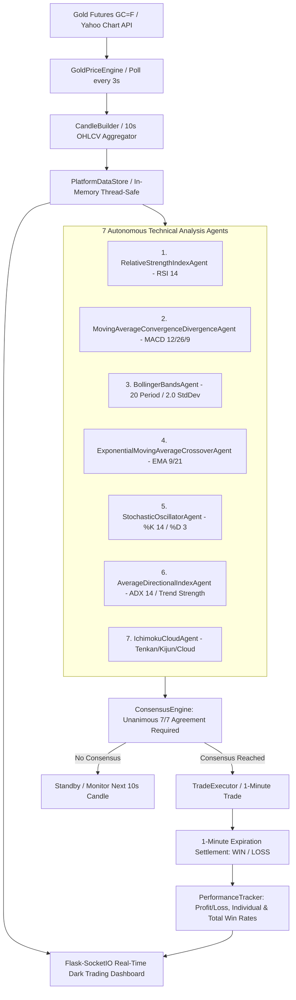

# Gold Trading Analysis Platform (1-Minute Fixed Time Trading)

An institutional-grade, multi-agent algorithmic trading system and live interactive dashboard designed for **1-minute Fixed Time Trading (FTT)** on Gold (`GC=F` / `XAUUSD`) using 10-second candlestick analysis and unanimous 7-agent consensus.

---

## System Architecture



---

## 7 Specialized Analysis Agents

| # | Agent Name | Indicator & Strategy | Time Horizon |
|---|---|---|---|
| **1** | [`RelativeStrengthIndexAgent`](file:///d:/Agents/mmm/agents/rsi_agent.py) | RSI (14 period). Detects oversold (<30 $\rightarrow$ CALL) and overbought (>70 $\rightarrow$ PUT) with divergence confirmation. | 10s / Intraday |
| **2** | [`MovingAverageConvergenceDivergenceAgent`](file:///d:/Agents/mmm/agents/macd_agent.py) | MACD (12, 26, 9). Detects MACD-to-signal line crossovers and histogram acceleration. | 10s / Intraday |
| **3** | [`BollingerBandsAgent`](file:///d:/Agents/mmm/agents/bollinger_agent.py) | Bollinger Bands (20, 2.0). Mean-reversion signals on band touches and volatility squeeze expansions. | 10s / Intraday |
| **4** | [`ExponentialMovingAverageCrossoverAgent`](file:///d:/Agents/mmm/agents/ema_crossover_agent.py) | Fast EMA (9) vs Slow EMA (21). Trend shift identification via exponential moving average crossovers. | 10s / Intraday |
| **5** | [`StochasticOscillatorAgent`](file:///d:/Agents/mmm/agents/stochastic_agent.py) | Fast Stochastic (%K 14, %D 3). Oversold bullish crossovers (<20) and overbought bearish crossovers (>80). | 10s / Intraday |
| **6** | [`AverageDirectionalIndexAgent`](file:///d:/Agents/mmm/agents/adx_agent.py) | ADX (14) + Directional Movement (DI+/DI-). Confirms trend strength (>25) and directional bias. | 10s / Intraday |
| **7** | [`IchimokuCloudAgent`](file:///d:/Agents/mmm/agents/ichimoku_agent.py) | Tenkan-sen (9), Kijun-sen (26), Senkou Span A & B. Breakout and cloud position analysis. | 10s / Intraday |

---

## Trade Execution Rules

1. **Unanimous Consensus Required (7 / 7)**: A trade is executed **ONLY** if all 7 analysis agents reach identical directional agreement (`CALL` or `PUT`) with an average confidence exceeding the configured threshold (default: $\ge 55\%$).
2. **Fixed Duration**: All trades execute with a strict 60-second (1-minute) expiration time.
3. **Payout & P&L**: Configured at standard Olymp Trade Fixed Time Trading demo return of **82%** ($+\$0.82$ profit per $\$1.00$ stake on WIN, $-\$1.00$ on LOSS).
4. **Accuracy Tracking**: Individual prediction success rates are tracked for each of the 7 agents separately alongside the total platform win rate and balance progression.

---

## Live Web Dashboard Features

- **TradingView Candlestick Chart**: Real-time 10-second candlesticks using Lightweight Charts.
- **Live Gold Price Ticker**: Real-time spot price with directional flashing animation (green/red).
- **7-Agent Signal Matrix**: Live confidence bars, signal badges (`CALL`, `PUT`, `NEUTRAL`), and individual success rates.
- **Consensus Status Panel**: Real-time agreement counter (`X / 7 Agreeing`) and consensus trigger display.
- **Active Trade Monitor**: Live 60-second countdown timer, entry price, live current price, and floating P&L.
- **Performance & P&L Tracker**: Win rate %, Net Profit/Loss ($), Account Balance ($), Win/Loss Streaks, and Historical Trades Table.

---

## Quickstart & Launch

### 1. Launch the Platform
```powershell
cd d:\Agents\mmm
.\venv\Scripts\python.exe main.py
```

### 2. Access the Dashboard
Open your web browser and navigate to:
```
http://127.0.0.1:5000
```

---

## Olymp Trade Account Integration

The platform includes [`OlympTradeClient`](file:///d:/Agents/mmm/trading/olymptrade_client.py) for executing trades directly on your Olymp Trade demo account.

To link your live Olymp Trade demo account:
1. Obtain your session token from your Olymp Trade browser session (under Developer Tools $\rightarrow$ Application $\rightarrow$ Cookies / Local Storage $\rightarrow$ `token` or authorization header).
2. Configure your credentials in [`config.py`](file:///d:/Agents/mmm/config.py) or invoke `client.set_credentials(auth_token="YOUR_TOKEN", account_id="YOUR_DEMO_ACCOUNT_ID")`.
3. When connected, trades are automatically dispatched via Olymp Trade's FTT order endpoint while maintaining real-time balance and trade status synchronization.
