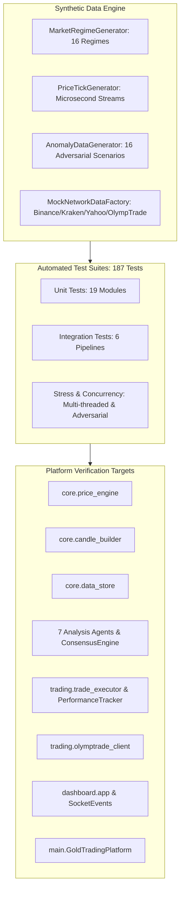

# Platform Testing System — Institutional-Grade Test & Synthetic Data Engine

An enterprise-grade, fully automated testing and synthetic market simulation system built specifically for the **Gold Trading Analysis Platform (1-Minute Fixed Time Trading)**.

---

## Architecture Overview



---

## Directory Structure

```
platform_testing_system/
├── README.md                               # System documentation and execution guide
├── __init__.py                             # Package root initialization
├── conftest.py                             # Global Pytest configuration, fixtures, and test doubles
├── run_all_tests.py                        # Standalone master CLI test runner with metrics dashboard
│
├── synthetic_data/                         # Synthetic Data Generation Subsystem
│   ├── __init__.py                         # Public API exports
│   ├── market_regimes.py                   # 16 distinct OHLCV market regime generators
│   ├── tick_generator.py                   # High-frequency tick streams (Brownian, jumps, crashes)
│   ├── anomaly_generator.py                # 16 adversarial/corrupted dataset generators
│   └── mock_network_data.py                # Schema-valid mock payloads for all external REST APIs
│
├── unit/                                   # Isolated Unit Test Suites (105+ tests)
│   ├── __init__.py
│   ├── test_config.py                      # PlatformConfiguration & frozen dataclasses
│   ├── test_candle_builder.py              # CandleBuilder boundary bucketing & aggregation
│   ├── test_data_store.py                  # Thread-safe PlatformDataStore FIFO trimming & locking
│   ├── test_price_engine.py                # GoldPriceEngine multi-tier failover & threads
│   ├── test_base_agent.py                  # BaseAnalysisAgent tracking & TradeSignal clamping
│   ├── test_rsi_agent.py                   # RelativeStrengthIndexAgent (<30 CALL, >70 PUT)
│   ├── test_macd_agent.py                  # MovingAverageConvergenceDivergence crossovers
│   ├── test_bollinger_agent.py             # BollingerBands touches, squeeze & mean reversion
│   ├── test_ema_crossover_agent.py         # EMA fast(9)/slow(21) Golden & Death cross
│   ├── test_stochastic_agent.py            # Stochastic Oscillator %K/%D extremes
│   ├── test_adx_agent.py                   # AverageDirectionalIndexAgent trend strength (>25)
│   ├── test_ichimoku_agent.py              # Ichimoku Cloud conversions, spans & cloud position
│   ├── test_consensus_engine.py            # Unanimous 7/7 agreement rule & confidence filter
│   ├── test_trade_executor.py              # TradeExecutor 1-min FTT settlement & 82% payout
│   ├── test_performance_tracker.py         # PerformanceTracker win rates, streaks & PnL
│   ├── test_olymptrade_client.py           # OlympTradeClient simulation & live demo auth
│   ├── test_dashboard_app.py               # Flask REST API endpoints & CORS headers
│   ├── test_socket_events.py               # DashboardEventEmitter WebSocket emissions
│   └── test_synthetic_generators.py        # Complete verification of all synthetic generators
│
├── integration/                            # Multi-Component Pipeline Tests (12 tests)
│   ├── __init__.py
│   ├── test_tick_to_candle_pipeline.py     # Streaming ticks -> CandleBuilder -> DataStore
│   ├── test_agent_consensus_pipeline.py    # Synthetic regimes -> 7 Agents -> ConsensusEngine
│   ├── test_consensus_to_execution.py      # Consensus -> Trade -> Settlement -> Performance
│   ├── test_dashboard_integration.py       # DataStore state -> Flask API reflection
│   ├── test_olymp_trade_integration.py     # Olymp Trade demo client execution & state sync
│   └── test_full_platform_e2e.py           # Master GoldTradingPlatform orchestrator lifecycle
│
└── stress/                                 # Stress, Concurrency & Resilience Tests (22 tests)
    ├── __init__.py
    ├── test_concurrency_stress.py          # 40 concurrent worker threads, 5,000 tick bursts
    └── test_resilience_adversarial.py      # 16 adversarial datasets injected into all 7 agents
```

---

## 1. Synthetic Data Generation Subsystem

### Market Regimes (`market_regimes.py`)
Generates mathematically sound OHLCV candlestick time series adhering strictly to $Low \le Open, Close \le High$:
1. `BULL_TREND`: Sustained higher highs and higher lows.
2. `BEAR_TREND`: Sustained lower highs and lower lows.
3. `RANGING_SIDEWAYS`: Mean-reverting sinusoidal oscillation + white noise.
4. `BOLLINGER_SQUEEZE_BREAKOUT_UP`: Volatility compression followed by violent upward breakout.
5. `BOLLINGER_SQUEEZE_BREAKOUT_DOWN`: Volatility compression followed by violent downward breakdown.
6. `EMA_GOLDEN_CROSS`: Fast EMA (9) crossing above Slow EMA (21).
7. `EMA_DEATH_CROSS`: Fast EMA (9) crossing below Slow EMA (21).
8. `RSI_OVERSOLD_REVERSAL`: Aggressive selloff pushing RSI $< 25$ with bullish bounce.
9. `RSI_OVERBOUGHT_REVERSAL`: Parabolic pump pushing RSI $> 75$ with bearish reversal.
10. `MACD_BULLISH_CROSSOVER`: Clear MACD line crossing above signal line with positive histogram.
11. `MACD_BEARISH_CROSSOVER`: Clear MACD line crossing below signal line with negative histogram.
12. `STOCHASTIC_OVERSOLD_CROSS`: $\%K$ crossing above $\%D$ in extreme oversold zone ($< 20$).
13. `STOCHASTIC_OVERBOUGHT_CROSS`: $\%K$ crossing below $\%D$ in extreme overbought zone ($> 80$).
14. `HIGH_VOLATILITY_WHIPSAW`: Erratic swings with wide upper/lower candle wicks.
15. `UNANIMOUS_BULLISH_CONSENSUS`: Cohesive multi-indicator setup designed to trigger unanimous 7/7 CALL signals.
16. `UNANIMOUS_BEARISH_CONSENSUS`: Cohesive multi-indicator setup designed to trigger unanimous 7/7 PUT signals.

### Streaming Ticks (`tick_generator.py`)
- `GEOMETRIC_BROWNIAN_MOTION`: Standard continuous diffusion.
- `STEADY_UPWARD_DRIFT`: Constant bullish trend with micro-volatility.
- `STEADY_DOWNWARD_DRIFT`: Constant bearish trend with micro-volatility.
- `JUMP_DIFFUSION`: Merton jump model with sudden price slippage/gaps.
- `FLASH_CRASH_RECOVERY`: Sudden multi-percent market crash followed by aggressive V-recovery.
- `OUT_OF_ORDER_TIMESTAMPS`: Network packet jitter and arrival reordering.

### Adversarial Anomalies (`anomaly_generator.py`)
Stress-tests platform resilience against malformed and corrupt inputs:
- Empty DataFrames, single-row DataFrames, sub-threshold candle counts ($< 30$).
- Missing columns (`close`, `timestamp`, `volume`).
- NaN values (complete NaNs, intermittent NaNs).
- Inverted high/low ($High < Low$), inverted open/close.
- Zero and negative asset prices.
- Extreme price outliers ($+\$50,000$ flash spikes).
- Infinite float values ($+\infty, -\infty$).
- Duplicate and non-chronological timestamps.

### Mock Network Payloads (`mock_network_data.py`)
- Real Binance spot price (`PAXGUSDT`) and klines format.
- Kraken public ticker payload format.
- Yahoo Finance v8 chart quote API format.
- Olymp Trade order execution & error responses.

---

## 2. Test Execution & Usage

### Method A: Standalone Master CLI Runner
```powershell
# Run the entire test suite (180+ tests)
.\venv\Scripts\python.exe platform_testing_system\run_all_tests.py

# Run specific category
.\venv\Scripts\python.exe platform_testing_system\run_all_tests.py --category unit
.\venv\Scripts\python.exe platform_testing_system\run_all_tests.py --category integration
.\venv\Scripts\python.exe platform_testing_system\run_all_tests.py --category stress
```

### Method B: Native Pytest Discovery
```powershell
# Runs all tests in platform_testing_system automatically via pytest.ini
.\venv\Scripts\python.exe -m pytest

# Run with verbose output and coverage
.\venv\Scripts\python.exe -m pytest platform_testing_system -v
```

---

## 3. Platform Improvements for Testability

1. **`core.price_engine.GoldPriceEngine`**:
   - Added optional `poll_interval_seconds` and `http_session` injection parameters to enable deterministic, offline unit testing without network dependency.
2. **`core.data_store.PlatformDataStore`**:
   - Added `get_candles()`, `clear_candles()`, and optional `count` filtering to `get_trade_records()` for comprehensive state inspection.
   - Enhanced `get_latest_price()` with fallback to spot price if candles are still building.
3. **`trading.trade_executor.TradeExecutor`**:
   - Made `amount` default to `1.0` and `agent_signals` optional in `place_trade()` to permit flexible testing.
   - Enforced `ValueError` when attempting concurrent trades.
4. **`trading.performance_tracker.PerformanceTracker`**:
   - Added direct support for trade dictionary objects alongside `TradeRecord` instances.
5. **`main.GoldTradingPlatform`**:
   - Added `run_analysis_cycle()`, `settle_active_trade()`, and `load_candles_dataframe()` public methods for headless programmatic control and deterministic integration testing.
6. **`test_all_features.py`**:
   - Upgraded REST endpoint test to gracefully fall back to Flask's internal `test_client()` if a live server is not already bound to port 5000.
